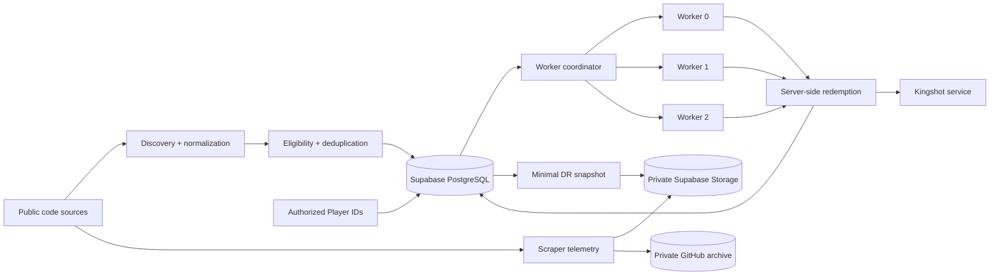
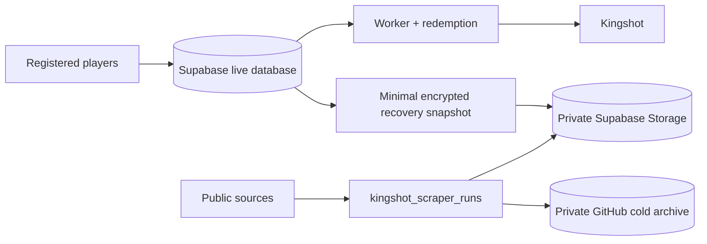

<div align="center">


# Kingshot Auto Redeemer

**A production-grade community service for discovering, tracking, and redeeming eligible Kingshot gift codes.**

[](https://kingshot-autoredeemer.vercel.app/)
[](https://kingshot-autoredeemer.vercel.app/)
[](https://github.com/Judson-web/kingshot-auto-redeemer/actions/workflows/guardrails.yml)
[](https://nodejs.org/)
[](https://react.dev/)
[](https://vite.dev/)
[](https://supabase.com/)
[](https://vercel.com/)
[](./LICENSE)

[**Open the service →**](https://kingshot-autoredeemer.vercel.app/) · [**How it works →**](https://kingshot-autoredeemer.vercel.app/info) · [**Report an issue →**](https://github.com/Judson-web/kingshot-auto-redeemer/issues)

</div>

> **Independent community service:** This project is not affiliated with, endorsed by, or operated by Century Games.

---

## ✦ At a glance

| Area | What it does |
|---|---|
| 🎁 **Code discovery** | Collects eligible public gift codes from configured sources |
| ⚙️ **Automatic redemption** | Processes registered Player IDs through coordinated workers |
| 🔁 **Backfill** | Catches eligible codes missed while a player was offline or unavailable |
| 👤 **Player validation** | Revalidates player and kingdom data when required |
| 📊 **Telemetry** | Tracks discovery, parsing, redemption, and operational outcomes; aggregate website analytics are archived separately |
| 🗄️ **Archive** | Keeps scraper history in a separate private archive |
| 🛡️ **Disaster recovery** | Maintains verified, encrypted recovery material |
| 🔐 **Security** | Uses server-side credentials, rate-aware behavior, and regression checks |
| 🔔 **Web push** | Optional browser notifications for verified new gift codes and authorized developer announcements, with optional HTTPS images |

## ✦ Account profiles and support

The public site has a floating support launcher for submitting a support ticket with a Player ID and message. It is a ticket workflow, not a promise of live-agent chat; replies are handled through the existing support process. The optional web-push setup checks permission and subscription state again when the page becomes active, so the prompt can return if that state changes after dismissal.

## ✦ Sign-in providers and roles

The public `/profile` page supports GitHub and Discord sign-in for a regular user profile. The header shows a neutral **USER** badge for profile-only sessions. Developer API access is a separate sign-in/session on `/developer`; only there does the account display the **DEVELOPER** or allowlisted **ADMIN** badge. Existing GitHub users should continue choosing GitHub and sign in with the same account. Choosing Discord is not a promise that two provider identities are merged; use the same provider identity you originally registered with unless Supabase identity linking is explicitly configured. Each developer account can manage only its own API keys.

### Enabling Discord OAuth (deployment maintainers)

This is deployment configuration, not a step required by ordinary users. Configure it only if you administer the deployment and have access to its Discord and Supabase projects.

1. Create or select an application in the [Discord Developer Portal](https://discord.com/developers/applications).
2. In Supabase → **Authentication → Sign In / Providers → Discord**, enable Discord and enter the application's Client ID and Client Secret.
3. Copy the **callback URL shown by that Supabase project** into the Discord application's OAuth2 redirect settings. Do not guess the project URL or copy a callback from another deployment.
4. In Supabase → **Authentication → URL Configuration**, add only the exact production and local redirect URLs the application actually uses. Match the scheme, hostname, path, and query string; keep wildcard redirects out of production unless strictly required.
5. Save the settings, then test both Discord and GitHub sign-in, including the expected profile/developer destinations and a non-owner account.

**Security notes**
- Never commit a Discord Client Secret, Supabase service-role key, admin passkey, session token, or other credential to this public repository.
- Keep secrets in the relevant provider dashboard or server-side deployment secret store. Anything bundled into browser code—including client-prefixed build variables—must be treated as public.
- The owner/admin role is decided server-side using configured, stable account identifiers and/or existing authorized identity checks—not a display name, avatar, or user-editable profile field. Keep actual owner identifiers out of public documentation and never use a client-side role flag as authorization.
- Discord and GitHub sign-in do not automatically merge identities. Users should use the provider associated with their existing account unless identity linking has been deliberately configured and tested.
- Keep the existing admin authentication path configured as documented in the private deployment runbook; do not publish passkeys or operational bypass details here.

## ✦ What it does

Kingshot Auto Redeemer automates the repetitive parts of gift-code redemption without turning the worker into a fragile one-off script.

The service can:

- discover eligible public gift codes from configured sources
- normalize and deduplicate codes before processing
- track code history and redemption outcomes
- automatically redeem codes for authorized Player IDs
- backfill eligible codes that were missed
- provide manual redemption through the website
- send optional web push alerts for verified new gift codes and authorized developer announcements
- support an optional publicly hosted HTTPS image in manual push announcements, with a preview in the private console
- revalidate player and kingdom information when required
- coordinate concurrent workers using durable database state
- retain a privacy-conscious scraper archive
- maintain an isolated disaster-recovery path for registered players

**Core rule:** the live Supabase database remains the operational source of truth for the production worker.

## ✦ Architecture



The production service runs on Vercel, with Supabase/PostgreSQL providing durable application state. The TypeScript migration is in progress: TypeScript 5.9 type-checking is part of CI, but the repository still contains JavaScript/JSX modules. Do not treat the migration as complete until the remaining modules are converted and the full regression suite passes.

The worker is coordinated through database-backed state rather than process-local memory. Worker sharding, leases, heartbeats, atomic claims, retry handling, and persistent redemption history are designed to prevent duplicate work across concurrent invocations.

Player lookups can refresh the stored profile of an already-registered Player ID when fresh provider data is available. This does not reset the scheduler's kingdom-validation cooldown.

The archive and disaster-recovery systems are downstream of production. **Normal redemption does not depend on GitHub, the cold archive, or the DR vault.** Recovery freshness is operational state and can change; consult the private archive's current recovery status before relying on any backup. This public README intentionally does not publish live backup identifiers, recovery checkpoints, or internal recovery gaps.

## ✦ Data & privacy boundary

Operational data and scraper history are intentionally separated.



### Live database

The live database contains the operational state required by the service, including registered Player IDs, player and kingdom information, registration state, and redemption history.

### Scraper archive

The scraper archive records discovery telemetry such as:

```text
id
source
checked_at
http_status
code_count
codes
parse_ok
error_category
error_message
```

It contains **no Player IDs, Discord IDs, account IDs, or registration IDs**.

The archive is not used by the worker to select players, claim redemptions, or execute redemption requests.

### Disaster recovery

The DR control plane maintains minimal registered-player recovery material separately from the production worker.

Recovery material is designed around the minimum state needed to restore missing registrations, including:

- `player_id`
- `enabled`
- `stale`
- snapshot metadata
- SHA-256 integrity data

It does not contain Discord IDs, authentication credentials, passkeys, session tokens, or redemption history.

Recovery is fail-closed. A recovery workflow validates the snapshot, compares it with Supabase, and inserts only missing records. Existing live records are not overwritten.

Registered-player snapshots are encrypted off-site with **AES-256-GCM**. The encryption key is stored outside the repository.

## ✦ Reliability & recovery

Backups are treated as an operational system, not as a folder full of JSON files.

The infrastructure includes:

- immutable, checksum-verified scraper archives
- encrypted registered-player recovery snapshots
- recovery-point chain validation
- off-site backup verification
- DR vault health checks
- restore rehearsals
- ephemeral restore testing
- RTO/RPO validation
- GitHub Actions automation

The recovery rehearsal restores into an **ephemeral SQLite database** and does not modify production.

The production database remains authoritative.

## ✦ Security model

Secrets are never committed to the repository.

Sensitive configuration is kept in deployment or repository secret stores, including:

- Supabase service-role credentials
- Kingshot/MightPulse API credentials
- Discord webhook credentials
- scheduler/authentication secrets
- DR encryption keys

The repository includes security regression checks and database privilege checks.

Privileged operational endpoints require server-side authentication. The public website does not expose privileged credentials or signing material.

### Rate limiting

Upstream rate limits are treated as upstream conditions. The service does **not** rotate IPs or attempt to bypass provider restrictions.

## ✦ Redemption outcomes

The redemption layer maps common upstream results into stable internal outcomes:

| Status | Meaning |
|---|---|
| `SUCCESS` | Redemption completed. |
| `RECEIVED` | Code was already redeemed/received. |
| `SAME TYPE EXCHANGE` | The relevant reward type was already handled. |
| `TIME_ERROR` | Code is expired. |
| `CDK_NOT_FOUND` | Code is invalid or unavailable. |
| `USAGE_LIMIT` | Code reached its usage limit. |

Transient upstream errors, rate limits, authentication failures, and stale-player conditions are tracked separately.

## ✦ Observability & guardrails

The CI/production checks cover more than whether the project compiles.

They include:

- security regression checks
- unit tests
- TypeScript type checking
- production build validation
- production smoke tests
- worker watchdog checks
- scheduled health verification
- disaster-recovery verification

The goal is simple: **a green build should mean more than “the frontend compiled.”**


## ✦ Website visitor telemetry

The public site records a minimal first-party page-view event through the existing operations catch-all route. It stores the request IP when available, Vercel-provided country/region/city/timezone, path without query parameters, referrer hostname, user-agent, inferred browser/OS/device category, accepted language, approximate screen-size class, and timestamp.

Visitor events are stored in the private `kingshot_visitor_events` table with row-level security enabled and no anonymous/authenticated client access. Only server-side service-role access is granted. A daily PostgreSQL cron job deletes records after 30 days. Collection is best-effort and rate-limited; client-side collection runs at most once per page path per tab session. It does not collect form values, game credentials, precise GPS, or a cross-site fingerprint. Hosting providers may independently process request metadata.

This tracker is separate from the public aggregate-only analytics visualized in the [archive README](https://github.com/Judson-web/Kingshot-auto-redeemer-archive#live-website-analytics). Raw IPs and detailed visitor rows are not copied into the long-term archive. See the [Privacy notice](https://kingshot-autoredeemer.vercel.app/privacy?service=kingshot-auto).

## ✦ Web push notifications

Web push is optional. Visitors can choose whether to enable notifications through the browser permission prompt; the site does not repeatedly prompt after a user dismisses the setup panel. Notifications can include alerts for verified new gift codes and manually composed announcements sent by an authorized operator.

The private push console is available at `/push` and requires its configured server-side passkey. An announcement can include an optional image URL. Images must already be hosted at a publicly accessible **HTTPS** URL; the console previews the image and the server validates the URL before sending. The service does not upload or store image files. Whether an image is shown depends on the recipient's browser, operating system, and notification surface; text and the notification title remain the fallback.

Push subscriptions are stored in the existing Supabase application database and are used to deliver notifications. A browser can revoke permission or unsubscribe at any time. Invalid or expired subscriptions are removed when the push provider reports them as no longer valid. Notification delivery is best-effort and is not guaranteed for every device.

Do not include secrets, personal data, or content you do not have permission to distribute in notification text or linked images. See the [Privacy notice](https://kingshot-autoredeemer.vercel.app/privacy?service=kingshot-auto) and [Terms](https://kingshot-autoredeemer.vercel.app/terms?service=kingshot-auto).

## ✦ Website

| Route | Purpose |
|---|---|
| `/` | Main service |
| `/auto` | Automatic redemption |
| `/manual` | Manual redemption |
| `/info` | Service documentation |
| `/push` | Private developer push-notification console (passkey required) |
| `/developer` | Developer portal, admin passkey, API key management, and player lookup |
| `/terms` | Terms of service |
| `/privacy` | Privacy information |

## ✦ Developer API

The `/developer` portal uses the existing admin passkey/session to create and revoke developer API keys. Key material is shown once and stored only as a SHA-256 hash in private database tables. An IP address can be issued at most two keys for its lifetime; revoking a key does not reset that cap. The read-only player lookup is available at `GET /api/v1/player?id=PLAYER_ID` with `Authorization: Bearer ks_live_…`. Limits are 60 requests/minute and 1,000 requests/day per key, plus 120 requests/minute per IP. Usage counters and issuance caps are database-backed so they remain consistent across serverless instances. The developer API is routed through the existing player-lookup serverless function to stay within the Vercel Hobby deployment function-count limit.

## ✦ Technology

| Layer | Technology |
|---|---|
| Frontend | React 19 + Vite 6 |
| Runtime | Node.js 24.x + TypeScript 5.9 |
| Deployment | Vercel |
| Database | Supabase PostgreSQL |
| Storage | Supabase Storage |
| Automation | GitHub Actions |
| Recovery | Private GitHub archive + encrypted DR vault; check archive README for live checkpoint/backup status |
| License | AGPL-3.0 |

## ✦ Local development

### Requirements

- Node.js **24.x**
- npm

### Install

```bash
npm install
```

### Development server

```bash
npm run dev
```

### Production build

```bash
npm run build
```

### Production preview

```bash
npm run preview
```

### Tests

```bash
npm test
```

### Type checking

```bash
npm run typecheck
```

## ✦ Environment & secrets

Production secrets are configured through the deployment environment and repository secret stores. Keep production and local-development credentials separate, grant each secret only the access it needs, and rotate a credential immediately if it is exposed.

Anything shipped to the browser is public—even if its name looks like an environment variable. Only non-sensitive public configuration belongs in client-side build variables.

**Never commit:**

- Supabase service-role or secret keys
- Kingshot/MightPulse credentials
- Discord credentials or webhook secrets
- scheduler/authentication secrets
- admin credentials
- session tokens
- DR encryption keys

Use local environment files only for development, and keep them outside version control.

## ✦ Acceptable use

Automation is permitted. Abuse is not.

Use only authorized Player IDs and legitimate public gift codes.

Do not use this project to:

- bypass quotas or authentication
- evade upstream rate limits
- rotate IPs to circumvent restrictions
- flood upstream endpoints
- intentionally create duplicate redemption work
- probe protected endpoints
- harvest private data
- manipulate redemption requests or results
- automate accounts or services without authorization

The service may throttle, suspend, revoke, or block access when necessary to protect users, the service, or upstream systems.

## ✦ Contributing

Production-sensitive areas include redemption behavior, worker coordination, database functions, authentication, API security, and recovery workflows.

Before submitting changes:

1. Keep changes focused.
2. Run `npm test`.
3. Run `npm run typecheck`.
4. Run `npm run build`.
5. Review security-sensitive changes carefully.
6. Never commit credentials or private user data.

For larger architectural changes, open an issue first so operational and recovery implications can be reviewed. Do not attach production logs, user identifiers, access tokens, database dumps, or recovery artifacts to public issues.

## ✦ Security reports

Please report suspected vulnerabilities privately rather than opening a public issue with exploit details. Use GitHub's [private vulnerability reporting page](https://github.com/Judson-web/kingshot-auto-redeemer/security/advisories/new) if it is available for this repository. Include the affected component, impact, and reproducible steps, while avoiding real user data and live credentials.

## ✦ Project status

This is an actively maintained production service, not a demo implementation.

The architecture deliberately favors boring, durable components over unnecessary infrastructure:

- one production database
- one queryable scraper archive
- one private cold-backup repository
- encrypted disaster-recovery snapshots
- deterministic worker coordination
- database-backed claims and leases
- automated validation and recovery checks

There is intentionally **no second production database, no IP-rotation layer, and no dependency on the cold archive during normal redemption.**

## ✦ License

This project is licensed under the **GNU Affero General Public License v3.0 (AGPL-3.0)**. See [LICENSE](./LICENSE).

AGPL-3.0 keeps the project open source while requiring modified versions offered as a network service to make their corresponding source available under the same license.

---

<div align="center">

**Built for reliable, boring redemption.**

<sub>Independent community software · No Century Games affiliation</sub>

</div>
