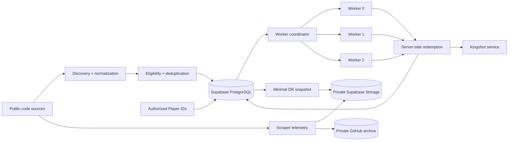
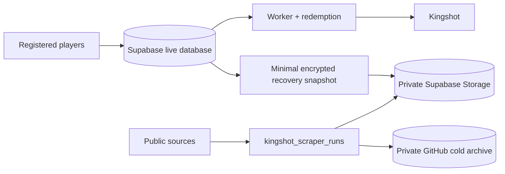

<div align="center">


# Kingshot Auto Redeemer

**A production-grade community service for discovering, tracking, and redeeming eligible Kingshot gift codes.**

[](https://kingshot-autoredeemer.vercel.app/)
[](https://kingshot-autoredeemer.vercel.app/)
[](https://github.com/Judson-web/kingshot-auto-redeemer/actions/workflows/verify.yml)
[](https://nodejs.org/)
[](https://react.dev/)
[](https://vite.dev/)
[](https://supabase.com/)
[](https://vercel.com/)
[](./LICENSE)

[**Open the service →**](https://kingshot-autoredeemer.vercel.app/) · [**How it works →**](https://kingshot-autoredeemer.vercel.app/info) · [**Contact support →**](https://kingshot-autoredeemer.vercel.app/developer)

</div>

> **Independent community service:** This project is not affiliated with, endorsed by, or operated by Century Games.

---

## ✦ At a glance

| Area | What it does |
|---|---|
| 🎁 **Code discovery** | Collects eligible public gift codes from configured sources |
| ⚙️ **Automatic redemption** | Processes registered Player IDs through coordinated workers |
| 🔁 **Backfill** | Catches eligible codes missed while a player was offline or unavailable |
| 👤 **Player validation** | Revalidates player and kingdom data when required |
| 📊 **Telemetry** | Tracks discovery, parsing, redemption, and operational outcomes; aggregate website analytics are archived separately |
| 🗄️ **Archive** | Keeps scraper history in a separate private archive |
| 🛡️ **Disaster recovery** | Maintains verified, encrypted recovery material and an independent Neon redemption-outcome journal |
| 🔐 **Security** | Uses server-side credentials, rate-aware behavior, and regression checks |
| 🔔 **Web push** | Optional browser notifications for verified new gift codes and authorized developer announcements, with optional HTTPS images |

## ✦ Account profiles and support

The public site has a floating support launcher for submitting a support ticket with a Player ID and message. It is a ticket workflow, not a promise of live-agent chat; replies are handled through the existing support process. The optional web-push setup checks permission and subscription state again when the page becomes active, so the prompt can return if that state changes after dismissal.

## ✦ Redemption experience

The Auto and Manual Redeem pages use the same compact navigation drawer on mobile, with an active-page state, keyboard dismissal, and background scroll locking.

Manual redemption returns one status-led card rather than repeating the submitted code. The card uses player context, a status-specific headline and concise next step, and shows a copyable reference only when the service returns one. Automatic registration keeps independent swipeable cards for multiple Player IDs; each card has a visible state badge so **registered**, **already active**, **re-enabled**, **disabled**, **blocked**, and **needs attention** are distinguishable.

Successful copy actions across the main site, gift-code manager, and developer tools emit the same accessible, short-lived confirmation (for example, **“Gift code copied successfully”**). Copy feedback is shown only after the browser confirms the clipboard write.

Player profile rendering uses the avatar image and profile fields provided by the upstream service. Research of the documented public Kingshot player field sets found an avatar URL but no equipped avatar-frame ID or frame asset URL; the UI does not infer or fabricate a decorative frame. A true frame renderer can be added if the provider exposes a stable, authoritative field.

## ✦ Sign-in providers and roles

The public `/profile` page supports GitHub and Discord sign-in for a regular user profile. Developer API access uses a separate Discord-based account/session on `/developer`; profile and developer identities are not assumed to be linked or merged. Only the developer portal displays the **DEVELOPER** or allowlisted **ADMIN** badge, and each developer account can manage only its own API keys.

### Enabling Discord OAuth (deployment maintainers)

This is deployment configuration, not a step required by ordinary users. Configure it only if you administer the deployment and have access to its Discord and Supabase projects.

1. Create or select an application in the [Discord Developer Portal](https://discord.com/developers/applications).
2. In Supabase → **Authentication → Sign In / Providers → Discord**, enable Discord and enter the application's Client ID and Client Secret.
3. Copy the **callback URL shown by that Supabase project** into the Discord application's OAuth2 redirect settings. Do not guess the project URL or copy a callback from another deployment.
4. In Supabase → **Authentication → URL Configuration**, add only the exact production and local redirect URLs the application actually uses. Match the scheme, hostname, path, and query string; keep wildcard redirects out of production unless strictly required.
5. Save the settings, then test both Discord and GitHub sign-in, including the expected profile/developer destinations and a non-owner account.

**Security notes**
- Never commit a Discord Client Secret, Supabase service-role key, session token, or other credential to this repository.
- Keep secrets in the relevant provider dashboard or server-side deployment secret store. Anything bundled into browser code—including client-prefixed build variables—must be treated as public.
- The owner/admin role is decided server-side using configured, stable account identifiers and/or existing authorized identity checks—not a display name, avatar, or user-editable profile field. Keep actual owner identifiers out of public documentation and never use a client-side role flag as authorization.
- Privileged tools reuse the existing verified Discord developer-account session and enforce the owner Discord identity server-side. Do not add a separate console passkey or a second sign-in flow.

## ✦ What it does

Kingshot Auto Redeemer automates the repetitive parts of gift-code redemption without turning the worker into a fragile one-off script.

The service can:

- discover eligible public gift codes from configured sources
- normalize and deduplicate codes before processing
- track code history and redemption outcomes
- automatically redeem codes for authorized Player IDs
- backfill eligible codes that were missed
- provide manual redemption through the website
- send optional web push alerts for verified new gift codes and authorized developer announcements
- support an optional publicly hosted HTTPS image in manual push announcements, with a preview in the private console
- revalidate player and kingdom information when required
- coordinate concurrent workers using durable database state
- retain a privacy-conscious scraper archive
- maintain an isolated disaster-recovery path for registered players

**Core rule:** Supabase remains the operational source of truth for the production worker. A separately hosted Neon PostgreSQL database is used only as an independent redemption-recovery journal; it does not replace Supabase or hold the authoritative player registry.

## ✦ Architecture



The production service runs on Vercel, with Supabase/PostgreSQL providing durable application state. The TypeScript migration is in progress: TypeScript 5.9 type-checking is part of CI, but the repository still contains JavaScript/JSX modules. Do not treat the migration as complete until the remaining modules are converted and the full regression suite passes.

The worker is coordinated through database-backed state rather than process-local memory. Worker sharding, leases, heartbeats, atomic claims, retry handling, and persistent redemption history are designed to prevent duplicate work across concurrent invocations.

### Independent redemption journal (Neon)

The worker writes a durable intent to the separately hosted Neon PostgreSQL journal before calling the upstream redemption service. When the upstream result is known, it records that outcome in Neon before attempting the normal Supabase history write. If Supabase history persistence fails, later worker runs can retry the history write from Neon without repeating the game redemption request. The same journaling flow covers normal worker attempts and validation-canary attempts.

Neon is a recovery aid, not a second source of truth: Supabase remains authoritative for application state and user-facing redemption history. If Neon is unavailable before an upstream call, the worker fails closed rather than making an unjournaled attempt. Ambiguous upstream transport failures are marked for review instead of being blindly retried. No design can guarantee recovery if the upstream accepts a redemption but both independent databases fail before the result is durably recorded; such cases require careful review.

Player lookups can refresh the stored profile of an already-registered Player ID when fresh provider data is available. This does not reset the scheduler's kingdom-validation cooldown.

The archive and disaster-recovery systems are downstream of production. **Normal redemption does not depend on GitHub, the cold archive, or the DR vault.** Recovery freshness is operational state and can change; consult the private archive's current recovery status before relying on any backup. This public README intentionally does not publish live backup identifiers, recovery checkpoints, or internal recovery gaps.

## ✦ Data & privacy boundary

Operational data and scraper history are intentionally separated.



### Live database

The live database contains the operational state required by the service, including registered Player IDs, player and kingdom information, registration state, and redemption history.

### Scraper archive

The scraper archive records discovery telemetry such as:

```text
id
source
checked_at
http_status
code_count
codes
parse_ok
error_category
error_message
```

It contains **no Player IDs, Discord IDs, account IDs, or registration IDs**.

The archive is not used by the worker to select players, claim redemptions, or execute redemption requests.

### Disaster recovery

The DR control plane maintains minimal registered-player recovery material separately from the production worker.

Recovery material is designed around the minimum state needed to restore missing registrations, including:

- `player_id`
- `enabled`
- `stale`
- snapshot metadata
- SHA-256 integrity data

It does not contain Discord IDs, authentication credentials, session tokens, or redemption history.

Recovery is fail-closed. A recovery workflow validates the snapshot, compares it with Supabase, and inserts only missing records. Existing live records are not overwritten.

Registered-player snapshots are encrypted off-site with **AES-256-GCM**. The encryption key is stored outside the repository.

## ✦ Reliability & recovery

Backups are treated as an operational system, not as a folder full of JSON files.

The infrastructure includes:

- immutable, checksum-verified scraper archives
- encrypted registered-player recovery snapshots
- recovery-point chain validation
- off-site backup verification
- DR vault health checks
- restore rehearsals
- ephemeral restore testing
- RTO/RPO validation
- GitHub Actions automation

The recovery rehearsal restores into an **ephemeral SQLite database** and does not modify production.

The production Supabase database remains authoritative. Neon holds only the independent redemption recovery journal; it is not a replacement database or a player-registration backup.

## ✦ Security model

Secrets are never committed to the repository.

Sensitive configuration is kept in deployment or repository secret stores, including:

- Supabase service-role credentials
- Kingshot/MightPulse API credentials
- Discord webhook credentials
- scheduler/authentication secrets
- DR encryption keys

The repository includes security regression checks, database privilege checks, and a scheduled OWASP ZAP passive scan of the deployed public site. ZAP reports are retained as GitHub Actions artifacts; findings are advisory while the baseline is being established.

The production edge sets a restrictive Content Security Policy, HSTS, `X-Content-Type-Options: nosniff`, `X-Frame-Options: DENY`, a referrer policy, and a Permissions Policy. CSP permits HTTPS images for external game avatars; this is intentionally broader than the font policy. These controls reduce risk but are not a substitute for authenticated API testing or a full penetration test.

Equipped MightPulse avatar frames are resolved by first mapping the in-game governor ID to MightPulse’s internal profile UID through its public search endpoint, then reading the public profile page, because the documented player API schema does not expose frame metadata. The browser talks only to the same-origin `/api/kingshot-player?frame=profile` route; server-side requests use fixed MightPulse hosts, strict numeric ID/asset validation, bounded timeouts, per-IP rate limits, and cache headers. Frame PNGs are proxied through the existing `/api/kingshot-player?frame=asset` handler, so this feature does not add a CORS exception, loosen the Content Security Policy, or consume another serverless-function slot. Profiles with no frame and upstream failures fall back to the ordinary avatar.

Privileged operational endpoints require server-side authentication. The public website does not expose privileged credentials or signing material.

### Rate limiting

Upstream rate limits are treated as upstream conditions. The service does **not** rotate IPs or attempt to bypass provider restrictions.

## ✦ Redemption outcomes

The redemption layer maps common upstream results into stable internal outcomes:

| Status | Meaning |
|---|---|
| `SUCCESS` | Redemption completed. |
| `RECEIVED` | Code was already redeemed/received. |
| `SAME TYPE EXCHANGE` | The relevant reward type was already handled. |
| `TIME_ERROR` | Code is expired. |
| `CDK_NOT_FOUND` | Code is invalid or unavailable. |
| `USAGE_LIMIT` | Code reached its usage limit. |

Transient upstream errors, rate limits, authentication failures, and stale-player conditions are tracked separately.

## ✦ Observability & guardrails

The CI/production checks cover more than whether the project compiles.

They include:

- security regression checks
- unit tests
- TypeScript type checking
- production build validation
- production smoke tests
- worker watchdog checks
- scheduled health verification
- disaster-recovery verification

The goal is simple: **a green build should mean more than “the frontend compiled.”**


## ✦ Website visitor telemetry

The service records a best-effort, rate-limited first-party page-view event. When available, the event includes the request IP address, Vercel-supplied country/region/city/timezone, page path without query parameters, referrer hostname, user-agent string, inferred browser/OS/device category, accepted language, approximate screen-size class, and timestamp. Collection runs at most once per page path per tab session and excludes form values and game credentials; it does not request precise GPS or build a cross-site advertising fingerprint.

Visitor events are stored in the `kingshot_visitor_events` table with RLS enabled and no anonymous/authenticated client access. Rows have a 30-day expiry and a daily PostgreSQL job purges expired rows. This describes the application event store; hosting providers may separately process request metadata under their own retention settings.

Developer API key management also stores SHA-256 hashes derived from client IP addresses for per-IP rate limits and the lifetime issuance cap. These hashes are pseudonymous, not guaranteed-anonymous. The current schema has no automatic expiry configured for issuance hashes or per-IP rate-limit rows; revoking a key does not remove these records. Raw visitor IPs and detailed visitor events are not copied into the long-term scraper archive. See the [Privacy notice](https://kingshot-autoredeemer.vercel.app/privacy?service=kingshot-auto) for provider and retention details.

## ✦ Web push notifications

Web push is optional. Visitors can choose whether to enable notifications through the browser permission prompt; the site does not repeatedly prompt after a user dismisses the setup panel. Notifications can include alerts for verified new gift codes and manually composed announcements sent by an authorized operator.

The private push console is available at `/push` and reuses the existing verified Discord developer-account session; only the configured owner Discord identity is authorized. If the session is missing, use the existing account section on `/developer` and return to `/push`—there is no separate console login. An announcement can include an optional image URL. Images must already be hosted at a publicly accessible **HTTPS** URL; the console previews the image and the server validates the URL before sending. The service does not upload or store image files. Whether an image is shown depends on the recipient's browser, operating system, and notification surface; text and the notification title remain the fallback.

Push subscriptions are stored in the existing Supabase application database and are used to deliver notifications. A browser can revoke permission or unsubscribe at any time. Invalid or expired subscriptions are removed when the push provider reports them as no longer valid. Notification delivery is best-effort and is not guaranteed for every device.

Do not include secrets, personal data, or content you do not have permission to distribute in notification text or linked images. See the [Privacy notice](https://kingshot-autoredeemer.vercel.app/privacy?service=kingshot-auto) and [Terms](https://kingshot-autoredeemer.vercel.app/terms?service=kingshot-auto).

## ✦ Website

| Route | Purpose |
|---|---|
| `/` | Main service |
| `/auto` | Automatic redemption |
| `/manual` | Manual redemption |
| `/info` | Service documentation |
| `/push` | Private push-notification console (existing verified Discord owner session) |
| `/developer` | Interactive developer portal and API reference |
| `/developer.md` | Plain-text API documentation for crawlers and integrations |
| `/openapi.json` | Machine-readable OpenAPI 3.1 specification |
| `/terms` | Terms of service |
| `/privacy` | Privacy information |

## ✦ Developer API (V3)

The interactive `/developer` portal provides account/key management and endpoint examples. Crawler-friendly documentation is available at [`/developer.md`](https://kingshot-autoredeemer.vercel.app/developer.md), and the machine-readable contract is the [OpenAPI 3.1 specification](https://kingshot-autoredeemer.vercel.app/openapi.json). Documentation does not provide credentials.

| Method | V3 endpoint | Purpose |
|---|---|---|
| `GET` | `/api/v3/players/{playerId}` | Read a player profile with provider-freshness metadata |
| `POST` | `/api/v3/redemptions` | Submit one manual redemption request |

The developer portal uses the existing verified Discord identity to create and revoke API keys. A key is shown once; only its SHA-256 hash, short prefix, label and lifecycle metadata are stored. Quotas are database-backed: 60 requests/minute and 1,000 requests/day per key, plus a shared 120 requests/minute per-IP limit. V3 standardizes nested error responses, request IDs, HTTP method/content-type validation and freshness signals from MightPulse. Errors use `error.code` and `error.message`; inspect `meta.requestId` when contacting support. A completed redemption rejection may still return HTTP 200, so always inspect `data.ok` and `data.status`. Do not blindly retry an ambiguous upstream timeout.

V1 developer endpoints `/api/v1/player?id=PLAYER_ID` and `/api/v1/redeem` are deprecated. Migrate integrations to V3 now: `GET /api/v3/players/{playerId}` and `POST /api/v3/redemptions`. Legacy routes currently remain operational during migration and return deprecation headers; do not build new integrations against them. Public website enrollment and internal worker routes are separate from this developer API; never call `/api/kingshot-auto` from third-party integrations. The V3 API is routed through the existing player-lookup serverless function to respect the deployment function-count limit.

## ✦ Technology

| Layer | Technology |
|---|---|
| Frontend | React 19 + Vite 6 |
| Runtime | Node.js 24.x + TypeScript 5.9 |
| Deployment | Vercel |
| Primary database | Supabase PostgreSQL (source of truth) |
| Redemption recovery journal | Neon PostgreSQL via `@neondatabase/serverless` |
| Storage | Supabase Storage |
| Automation | GitHub Actions |
| Recovery | Private GitHub archive + encrypted DR vault; check archive README for live checkpoint/backup status |
| License | AGPL-3.0 |

## ✦ Local development

### Requirements

- Node.js **24.x**
- npm

### Install

```bash
npm install
```

### Development server

```bash
npm run dev
```

### Production build

```bash
npm run build
```

### Production preview

```bash
npm run preview
```

### Tests

```bash
npm test
```

### Type checking

```bash
npm run typecheck
```

## ✦ Environment & secrets

Production secrets are configured through the deployment environment and repository secret stores. Keep production and local-development credentials separate, grant each secret only the access it needs, and rotate a credential immediately if it is exposed.

Anything shipped to the browser is public—even if its name looks like an environment variable. Only non-sensitive public configuration belongs in client-side build variables.

**Never commit:**

- Supabase service-role or secret keys
- Kingshot/MightPulse credentials
- Discord credentials or webhook secrets
- scheduler/authentication secrets
- admin credentials
- session tokens
- DR encryption keys

Use local environment files only for development, and keep them outside version control.

## ✦ Acceptable use

Automation is permitted. Abuse is not.

Use only authorized Player IDs and legitimate public gift codes.

Do not use this project to:

- bypass quotas or authentication
- evade upstream rate limits
- rotate IPs to circumvent restrictions
- flood upstream endpoints
- intentionally create duplicate redemption work
- probe protected endpoints
- harvest private data
- manipulate redemption requests or results
- automate accounts or services without authorization

The service may throttle, suspend, revoke, or block access when necessary to protect users, the service, or upstream systems.

## ✦ Contributing

Production-sensitive areas include redemption behavior, worker coordination, database functions, authentication, API security, and recovery workflows.

Before submitting changes:

1. Keep changes focused.
2. Run `npm test`.
3. Run `npm run typecheck`.
4. Run `npm run build`.
5. Review security-sensitive changes carefully.
6. Never commit credentials or private user data.

For larger architectural changes, open an issue first so operational and recovery implications can be reviewed. Do not attach production logs, user identifiers, access tokens, database dumps, or recovery artifacts to public issues.

## ✦ Security reports

Report suspected vulnerabilities through the website support channel at [the developer portal](https://kingshot-autoredeemer.vercel.app/developer). Do not include credentials, live API keys, session tokens, real player data, or exploit details in a general support message. For sensitive reproduction details, ask for a private follow-up channel first.

## ✦ Project status

This is an actively maintained production service. Supabase remains the production source of truth, Neon is limited to the independent redemption-recovery journal, and the cold archive is not on the normal redemption path. The service uses database-backed worker coordination and automated verification rather than IP rotation or quota evasion.

## ✦ License

This project is licensed under the **GNU Affero General Public License v3.0 (AGPL-3.0)**. See [LICENSE](./LICENSE).

AGPL-3.0 keeps the project open source while requiring modified versions offered as a network service to make their corresponding source available under the same license.

---

<div align="center">

**Built for reliable, boring redemption.**

<sub>Independent community software · No Century Games affiliation</sub>

</div>
